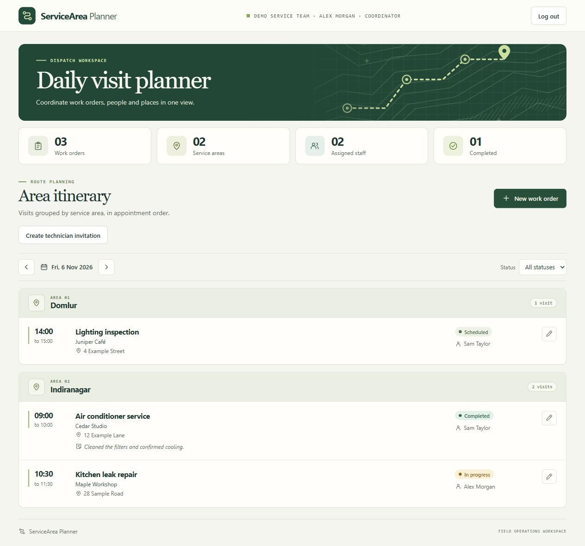
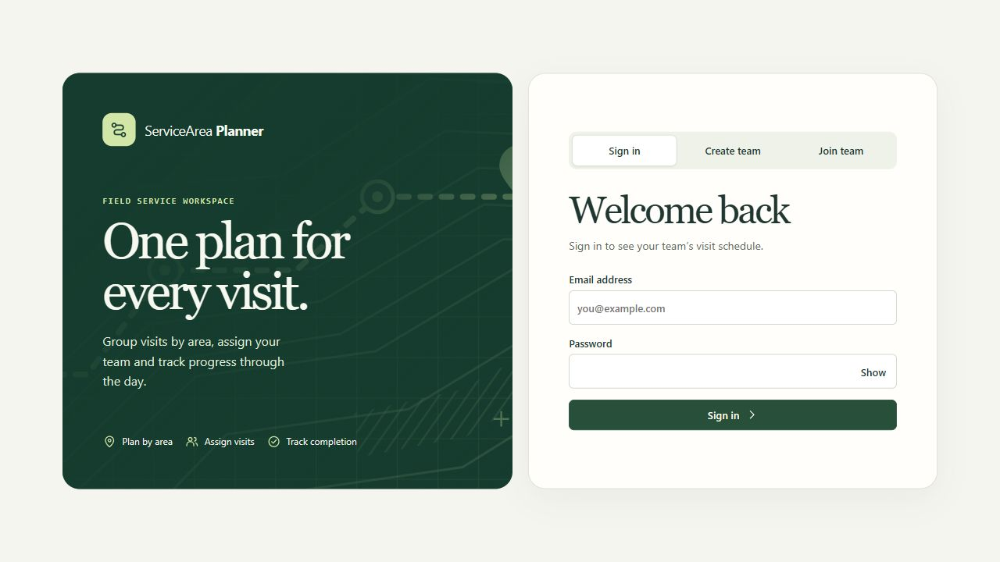

# ServiceArea Planner

**CIA assignment · N DARSHIT · 2102508605**

**[Open the live application](https://servicearea-planner.onrender.com/) · [Run locally](#run-locally) · [Evaluator walkthrough](#evaluator-walkthrough)**

ServiceArea Planner helps small field-service teams schedule visits, assign technicians and track completed work. The daily itinerary groups visits by service area and lists them in appointment order so coordinators can plan routes manually.



*Coordinator itinerary with fictional visits.*

<details>
<summary>View the sign-in screen</summary>



</details>

The first visit to the live application may take longer while Render wakes the service. Use fictional customer information when trying the app.

## What each role can do

| Role | Workflow |
| --- | --- |
| Coordinator | Create a team, invite technicians, schedule and assign visits, and edit or delete work orders. |
| Technician | Join a team using an invitation, view the daily itinerary, and update the status and completion notes of assigned visits. |

## Run locally

Install Node.js 24.21.0 (the pinned runtime). From the project folder, run the following commands.

```powershell
npm ci
npm run demo
```

Open **http://127.0.0.1:4000**. On first use, the demo downloads a MongoDB server binary. The Windows download is about 600 MB. Subsequent launches reuse the cached binary.

Create a coordinator account using **Create team**. A new team starts with an empty itinerary. The local database is saved in `.local/demo-data/`. Stop the demo with Ctrl+C.

Create a technician invitation from the dashboard and share its link. Invitations are single-use and expire after 24 hours. The technician can register through the link and then be assigned visits.

## Evaluator walkthrough

1. Open the live app and choose **Create team** to register as the coordinator.
2. Select **Create technician invitation**. In a private browser window, choose **Join team**, paste the full invitation link, and register with a different email address.
3. In the coordinator window, select **New work order** and assign a fictional visit to the technician. Add a second visit in the same area with a different start time to see the grouping and ordering.
4. In the technician window, refresh the itinerary and open the assigned visit. Choose **Completed**, enter completion notes, and save. Refresh the coordinator window and filter by **Completed** to verify the change.
5. Sign out and sign back in to see that the work orders persist.

## How it works

- **React** requests work orders for the selected local date. The itinerary groups area names case-insensitively, sorts visits by start time, and can filter the results by status.
- **Node.js and Express** serve the React build and REST API from the same origin. The API uses cookie sessions, enforces team and role permissions, and validates appointment windows and completion notes.
- **MongoDB** stores accounts, sessions, invitations, and work orders. Work orders are indexed by team, date, area and start time. The hosted app uses MongoDB Atlas.

The live app runs on Render. See [DEPLOYMENT.md](DEPLOYMENT.md) for setup and deployment checks.

| Method | Endpoint | Result |
| --- | --- | --- |
| GET | `/api/health` | Checks MongoDB connectivity |
| POST | `/api/auth/register`, `/api/auth/login`, `/api/auth/join` | Creates a coordinator, signs in, or accepts a technician invitation |
| POST | `/api/team/invitations` | Issues a single-use technician invitation |
| GET | `/api/work-orders?date=2026-11-04` | Returns work orders for that date |
| POST | `/api/work-orders` | Creates a work order and returns its ID |
| PATCH | `/api/work-orders/:id` | Updates the specified fields and returns the saved order |
| DELETE | `/api/work-orders/:id` | Removes the selected order |

## Use an existing MongoDB instance

Copy `.env.example` to `.env`. Set `MONGODB_URI` to a URI that includes the database name, or supply a separate `MONGODB_DB`. The normal server defaults to a local MongoDB instance and listens on the loopback interface.

```powershell
npm run build
npm start
```

For front-end development, run `npm run api` and `npm run dev` in separate terminals. Vite prints the development URL and forwards API requests to Express. Existing standalone seed records do not belong to a team.

## Verify the implementation

```powershell
npm test
npm run build
```

The integration suite uses a temporary MongoDB server. It checks work-order validation and persistence, role and team isolation, session expiry, single-use invitations, and login throttling.

| File | Responsibility |
| --- | --- |
| `src/main.jsx` | Daily itinerary, date navigation, status filtering and summary counts |
| `src/OrderDialog.jsx` | Create, edit, complete and delete a visit |
| `server/app.js` | REST endpoints and error handling |
| `server/work-orders.js` | Work-order validation and API representation |
| `server/start.js` | Database connection, index and HTTP server lifecycle |
| `scripts/demo.js` | Starts the disk-backed local demo |
| `tests/work-orders.test.js` | HTTP and MongoDB integration checks |

## Scope

The itinerary supports manual route planning. Account recovery, email verification, member removal, invitation revocation, and real-time updates are outside the current scope.
